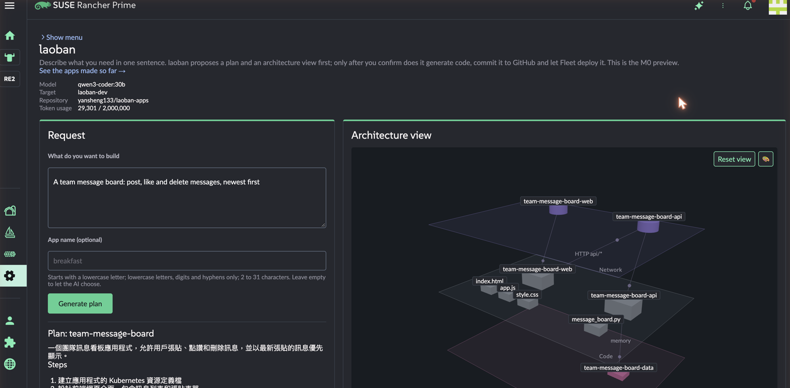
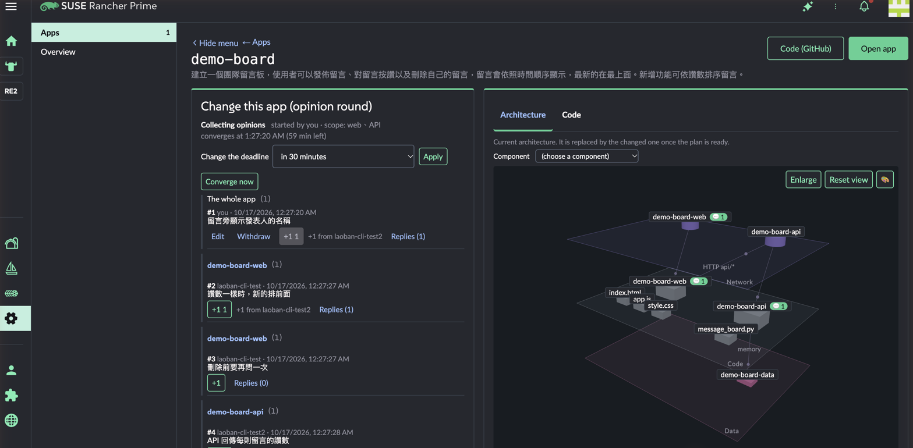

# laoban

[繁體中文](README.md) · English · [日本語](README.ja.md)

laoban (老闆, "the boss") is a Rancher UI extension: describe the app you want in one sentence, and the AI first proposes a plan and a 3D architecture diagram; it writes code only after you confirm. The code goes to GitHub, and Fleet deploys it to clusters managed by Rancher. Once the app is built, the team can comment on components together in the 3D architecture diagram; the AI consolidates the comments into a single change plan, and a new version is released only after everyone who commented has confirmed.

> The project nickname is "Teppan noodles with chicken nuggets" (鐵板麵加雞塊). Where the name comes from: telling the system what you need is like ordering from the boss at a Taiwanese breakfast shop.


| One sentence → plan and 3D architecture diagram | Comment together | AI consolidates into a change plan |
|---|---|---|
|  |  |  |
| **Deployed** | **Version comparison** | **App list** |
|  |  |  |

The video and most screenshots show the Traditional Chinese UI; the UI is also available in English and Japanese.

## Try it

Follow the **[quickstart](docs/quickstart.en.md)**; it takes about 30 minutes:

1. In Rancher Extensions, add the Helm repo `https://yansheng133.github.io/laoban` and install **laoban** (0.1.18 or later; the 0.1.17 extension fails to load).
2. Install the backend with Helm (`laoban/laoban-crd`, `laoban/laoban`).
3. Create a Fleet GitRepo pointing to the GitHub repo that holds the apps.

You need Rancher 2.15, a GitHub repo and token, and an Anthropic API key (or a compatible local model). See [Releases](https://github.com/yansheng133/laoban/releases) for the changes in each version.

## Status

Preview (M0), version 0.1.x, still under heavy change and not yet formally released. Built against Rancher Prime 2.15.2, and so far fully verified only on ARM64. See [docs/m0-design.md](docs/m0-design.md) for the M0 scope and specification.

laoban is a community open-source project and is **not covered by SUSE support**.

## What it can do now

**Build a new app**
- Enter a one-sentence request in **Overview**, and the AI returns a plan (summary, steps) and a 3D architecture diagram.
- After you confirm, the AI writes the code (web page plus API), applies a fixed deployment template, commits it to GitHub, and Fleet deploys it. The page tracks the deployment status and gives you a link to the app when it is done.
- Generated apps always have two components, a web page and an API, running on the SUSE BCI Python image.

**Change it together: rounds of opinions**
- On an app's detail page, start a round of opinions and set the consolidation time (immediately, or 10 minutes to 24 hours) and the scope (web page, API, or the whole app).
- Everyone can post a general comment, or click a component in the 3D diagram and comment on that component; you can write one comment each for several components at once.
- Comments can be +1'd and replied to; during the collection period, authors can rewrite or withdraw their own comments. The 3D diagram shows how many comments each component has.
- Half-written drafts are saved in the round, so they are still there when you switch computers; by default, other people can see them too.
- The initiator can adjust the deadline or consolidate immediately.
- Everyone can leave comments on individual steps of the consolidated plan; when someone raises an objection, those comments are passed to the AI together with the opinions.
- When time is up, the AI consolidates all opinions (grouped by component, with +1s and replies attached) into one change plan, and marks in the 3D diagram which parts will be added, changed, or removed.
- After everyone who commented has confirmed, the AI writes the code and releases a new version. Objections can send the plan back for re-consolidation; the initiator can skip people who have not responded.
- A round is stored in the cluster and continues as normal after the backend restarts or is upgraded; finished rounds are archived to the `laoban-rounds` branch of the app repo, and the detail page shows every past round.
- Rounds waiting for your confirmation are marked in the app list, and the left menu shows the count; people who have confirmed can see who is still pending and whether anything failed.
- Comments and replies have a length limit; the page shows the character count and the remaining space in the round in real time. Pasting overly long text does not truncate it, but you must shorten it before you can submit.

**Understand the architecture and versions**
- The 3D architecture diagram has three layers: network, code, and data. You can rotate, zoom, and drag components to adjust the layout and save it as a new version.
- The 3D diagram can be expanded to fill the window or go full screen; the sidebar has a version timeline, a change list, and comments.
- Every version is a Git commit. Pick an old version to compare it with the previous version (what this version changed) or with the current version (what restoring it would change). The change list shows the architecture changes and the code files touched. You can restore any version.
- The 3D diagram has four color schemes; the selected component is marked with a halo and its connections.

**Changes without the AI**
- The code tab lets you edit the four code files directly and save them as a new version (passing the same checks as AI-generated code).
- "Edit structure" lets you rename, delete, or add connections or modules in the 3D diagram; these become change requests that then go through an AI plan and confirmation.

**Identity and permissions**
- The backend is a Kubernetes aggregated API: the browser calls it through the Rancher proxy with the user's own login, the API server authenticates the user, and authorization uses the user's RBAC. People with edit permission in the target namespace can use it, and people with view can look.
- Rancher Project members can use the Project roles "laoban user" and "laoban viewer" (`deploy/rancher/`).
- Every version and every comment records who made it.

**Other**
- The UI is available in Traditional Chinese, English, and Japanese, following the Rancher language setting.
- Rancher's side menu can be collapsed to leave more room for the workspace.
- AI work (planning, writing code, consolidation) runs in the background on the backend, and the page polls for progress, so it is not affected by the API server's request limit of about 60 seconds.
- Common kinds of sensitive data (Taiwan ID numbers, card and account numbers, API keys and tokens, private keys, passwords) are masked before being sent to the AI. Masking works by recognising formats and cannot catch every secret, so do not put secrets in requests or opinions. There is a global token usage cap.
- The AI can use the Anthropic API or a local model compatible with the Anthropic Messages API (for example, Ollama).
- Error responses are also Kubernetes `Status` objects, so `kubectl create --raw` shows the reason as well (the backend writes its messages in Traditional Chinese; the page shows common errors in its own language).

## How it works

```
Browser (laoban page in Rancher)
  │  with the user's own Rancher login
  ▼
Rancher proxy → Kubernetes API server of the target cluster (authentication, RBAC authorization)
  ▼
laoban backend (aggregated API) ── masking ──► AI (Anthropic API or local model)
  │  commits code and deployment templates
  ▼
GitHub repo ──► Fleet ──► app in the target namespace
```

The backend writes only its own state resources in `laoban-system` (`Round` for rounds of opinions, `Plan` for plans waiting for confirmation and `TokenUsage` for the monthly token count, so they survive a backend restart or upgrade); Fleet handles all app deployment.

## Limitations

- One Rancher uses only one backend: the page finds the first cluster with laoban installed among the clusters the user can see.
- Generated apps always have two components, web page plus API (Python), deployed in one namespace (default `laoban-dev`) and run under Pod Security restricted.
- The backend has only one replica; rounds of opinions, plans waiting for confirmation and the monthly token usage are stored in `Round`, `Plan` and `TokenUsage` resources in `laoban-system`, so a backend restart does not lose them.
- AI costs are paid by your Anthropic account. The backend has a monthly token cap (default 2,000,000), but it is only laoban's own count; be sure to set a spend limit in the Anthropic Console.
- Backend messages are in English by default; set the chart's `config.language: zh-Hant` for Traditional Chinese. The page follows Rancher's language setting.

## Installation (details)

- General use: see [docs/quickstart.en.md](docs/quickstart.en.md).
- All backend chart settings: [charts/laoban/README.md](charts/laoban/README.md).
- Namespaces and Fleet objects to create in advance: [deploy/m0/README.md](deploy/m0/README.md).
- Rancher Project roles: [deploy/rancher/README.md](deploy/rancher/README.md).
- Developing and building the UI extension: [extension/README.md](extension/README.md).
- Building and signing the container image: [build/README.md](build/README.md).
- Release process: after you push a `vX.Y.Z` tag, the `image` workflow builds the container image, and the `publish` workflow adds the extension and both charts to the Helm repo on the `gh-pages` branch and creates a GitHub Release.

## Directory layout

| Path | Description |
|---|---|
| `extension` | Rancher UI extension (`laoban-ext`): overview, app list, app detail page (rounds of opinions, 3D architecture diagram, versions, code). See [extension/README.md](extension/README.md) |
| `crates/laoban-server` | Backend service: aggregated API (TLS, request-header authentication), health checks |
| `crates/laoban-m0` | Preview flow: AI plan and architecture diagram, code generation, rounds of opinions, versions and restore, fixed-template manifests, commits to GitHub |
| `crates/laoban-ai` | AI call coordination layer: provider abstraction, error classification and retries, global token budget, masking before sending, prompt injection mitigation, structure and allowlist validation of AI responses |
| `crates/laoban-mask` | Sensitive data masking engine: the same rules are used before sending to the AI and before writing audit records |
| `crates/laoban-audit` | Audit records: masked RFC 5424 syslog messages, RFC 5425 framing, and size-based rotation of local files |
| `crates/laoban-policy` | Deployment review policy engine (for phase 1): decides whether a change can be deployed directly, whether it needs human review, and who reviews it |
| `crates/laoban-mockhttp` | Local mock HTTP server for tests |
| `charts/laoban` | Backend Helm chart: Deployment, APIService, user RBAC rules, Role for the backend to store Round, Plan and TokenUsage |
| `charts/laoban-crd` | laoban CRDs: `Round`, `Plan` and `TokenUsage` (required already in the preview), plus ProjectPolicy, ChangeRequest, and ArchitectureVersion for phase 1 |
| `deploy/m0` | Namespaces and Fleet objects to create in advance for the preview |
| `web/viewer-prototype` | Prototype of the 3D architecture view; the extension's 3D diagram was ported from it |
| `Containerfile`, `build/` | Container image: SUSE BCI multi-stage build, native x86-64/ARM64 builds, push to GHCR, cosign signing and SBOM |
| `docs/m0-design.md` | Preview design: scope, API, flows, pages, and settings |

## Development

```bash
# Backend
cargo test --workspace
cargo clippy --workspace --all-targets -- -D warnings

# UI extension
cd extension
yarn install --frozen-lockfile
yarn build-pkg laoban-ext
yarn test

# 3D prototype
node --test web/viewer-prototype/*.test.mjs
```

## Support

laoban is a community open-source project and is not covered by SUSE support. Please open a [GitHub issue](https://github.com/yansheng133/laoban/issues) for problems.

## License

Apache License 2.0, see [LICENSE](LICENSE).
