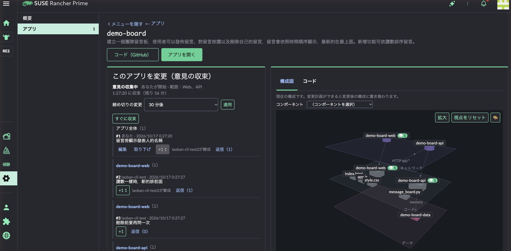

# laoban

[繁體中文](README.md) · [English](README.en.md) · 日本語

laoban（老闆、「ボス」）は Rancher UI extension です。作りたいアプリを一文で説明すると、AI がまず計画と 3D アーキテクチャ図を提案し、確認してからコードを書きます。コードは GitHub に書き込まれ、Fleet が Rancher の管理するクラスターにデプロイします。アプリができた後は、チームで 3D アーキテクチャ図上のコンポーネントに意見を出し合えます。AI が意見を 1 つの変更計画にまとめ、意見を出した全員が確認してから新しいバージョンがリリースされます。

> プロジェクトの愛称は「鉄板麺とチキンナゲット」（鐵板麵加雞塊）です。名前の由来は、システムに要望を伝えるのが、台湾の朝食屋で店主（老闆）に注文するようなものだからです。


| 一文 → 計画と 3D アーキテクチャ図 | みんなで意見を出す | AI が変更計画にまとめる |
|---|---|---|
|  |  |  |
| **デプロイ完了** | **バージョン比較** | **アプリ一覧** |
|  |  |  |

動画とほとんどのスクリーンショットは繁体字中国語の UI です。UI は英語と日本語にも対応しています。

## 試してみる

**[クイックスタート](docs/quickstart.ja.md)** に沿って進めると、約 30 分で終わります。

1. Rancher の Extensions に Helm repo `https://yansheng133.github.io/laoban` を追加し、**laoban** をインストールします（0.1.18 以降。0.1.17 の extension は読み込めません）。
2. Helm でバックエンド（`laoban/laoban-crd`、`laoban/laoban`）をインストールします。
3. アプリを置く GitHub repo を指す Fleet GitRepo を作成します。

Rancher 2.15、GitHub repo と token、Anthropic API key（または互換のローカルモデル）が必要です。各バージョンの変更点は [Releases](https://github.com/yansheng133/laoban/releases) を参照してください。

## ステータス

試食版（M0）、バージョン 0.1.x です。現在も頻繁に変更しており、まだ正式リリースしていません。Rancher Prime 2.15.2 を基準とし、現時点で完全に検証済みなのは ARM64 のみです。M0 の範囲と仕様は [docs/m0-design.md](docs/m0-design.md) を参照してください。

laoban はコミュニティのオープンソースプロジェクトであり、**SUSE のサポート対象外です**。

## 現在できること

**新しいアプリを作る**
- 「概要」で要望を一文入力すると、AI が計画（概要、手順）と 3D アーキテクチャ図を返します。
- 確認すると、AI がコード（Web ページと API）を書き、固定のデプロイテンプレートを適用して GitHub に commit し、Fleet がデプロイします。ページはデプロイ状況を追跡し、完了するとアプリへのリンクを表示します。
- 生成されるアプリは常に Web ページと API の 2 つのコンポーネントで構成され、SUSE BCI Python イメージ上で動作します。

**みんなで修正する：意見のラウンド**
- アプリの詳細ページで意見のラウンドを開始し、取りまとめのタイミング（即時、または 10 分～24 時間）と範囲（Web ページ、API、またはアプリ全体）を設定します。
- 各メンバーは一般的な意見を出すことも、3D 図上のコンポーネントをクリックしてそのコンポーネントについて意見を出すこともできます。複数のコンポーネントにそれぞれ 1 件ずつ、まとめて書くこともできます。
- 意見には +1 や返信ができます。収集期間中、作成者は自分の意見を書き直したり取り下げたりできます。3D 図には各コンポーネントの意見の件数が表示されます。
- 書きかけの下書きはラウンド内に保存されるため、別のコンピューターに替えても残っています。デフォルトでは他のメンバーからも見えます。
- 発起人は締め切りを調整したり、すぐに取りまとめたりできます。
- 取りまとめた計画の各ステップには、みんながコメントを残せます。誰かが異議を出すと、それらのコメントも意見と一緒に AI に渡されます。
- 時間になると、AI がすべての意見（コンポーネントごとにグループ化し、+1 と返信を添付）を 1 つの変更計画にまとめ、追加・変更・削除される部分を 3D 図上に示します。
- 意見を出した全員が確認すると、AI がコードを書いて新しいバージョンをリリースします。異議があれば差し戻して取りまとめ直せます。発起人は応答のないメンバーをスキップできます。
- ラウンドはクラスター内に保存され、バックエンドの再起動やアップグレード後もそのまま続きます。終了したラウンドはアプリ repo の `laoban-rounds` ブランチにアーカイブされ、詳細ページで過去のすべてのラウンドを確認できます。
- 自分の確認待ちのラウンドはアプリ一覧に表示され、左側のメニューにも件数が表示されます。確認済みのメンバーは、まだ誰を待っているか、失敗していないかを確認できます。
- 意見と返信には文字数の上限があり、ページには文字数とこのラウンドの残り容量がリアルタイムで表示されます。長すぎるテキストを貼り付けても切り捨てられませんが、短くしないと送信できません。

**アーキテクチャとバージョンを把握する**
- 3D アーキテクチャ図はネットワーク、コード、データの 3 層に分かれています。回転、拡大縮小、コンポーネントのドラッグでレイアウトを調整し、新しいバージョンとして保存できます。
- 3D 図はウィンドウ全体またはフルスクリーンに拡大でき、サイドバーにはバージョンのタイムライン、変更一覧、意見があります。
- 各バージョンは 1 つの Git commit です。古いバージョンを選ぶと、前のバージョンと比較（このバージョンで何が変わったか）することも、現在のバージョンと比較（復元すると何が変わるか）することもできます。変更一覧にはアーキテクチャの変更と、変更されたコードファイルが表示されます。どのバージョンにも復元できます。
- 3D 図には 4 種類の配色があり、選択したコンポーネントは光の輪と接続線で示されます。

**AI を介さない修正**
- コードタブで 4 つのコードファイルを直接編集し、新しいバージョンとして保存できます（AI が生成したコードと同じチェックを通ります）。
- 「構造を変更」では、3D 図上で名前の変更、削除、接続やモジュールの追加ができます。これらは修正意見となり、AI の計画と確認を経て反映されます。

**ID と権限**
- バックエンドは Kubernetes aggregated API です。ブラウザーは Rancher のプロキシを経由し、ユーザー自身のログインで呼び出します。API server が認証し、ユーザーの RBAC で認可します。対象 namespace で edit 権限を持つユーザーは利用でき、view 権限を持つユーザーは閲覧できます。
- Rancher Project のメンバーは、Project ロール「laoban user」「laoban viewer」（`deploy/rancher/`）を使えます。
- すべてのバージョンと意見に、誰が行ったかが記録されます。

**その他**
- UI は繁体字中国語、英語、日本語に対応し、Rancher の言語設定に従います。
- Rancher のサイドメニューを折りたたんで、作業領域を広く使えます。
- AI の処理（計画、コード作成、取りまとめ）はバックエンドのバックグラウンドで実行され、ページは進捗を照会するため、API server の約 60 秒のリクエスト上限の影響を受けません。
- AI に送信する前に、よくある機密データ（台湾の身分証番号、カード番号や口座番号、API key・token、秘密鍵、パスワード）をマスクします。形式で判別するため、すべての機密を検出できるわけではありません。要望や意見に機密を書かないでください。グローバルな token 使用量の上限があります。
- AI には Anthropic API のほか、Anthropic Messages API 互換のローカルモデル（例：Ollama）も接続できます。
- エラーレスポンスは Kubernetes の `Status` でもあるため、`kubectl create --raw` でも理由を確認できます（バックエンドのメッセージは繁体字中国語です。ページでは主なエラーを UI の言語で表示します）。

## 仕組み

```
ブラウザー（Rancher 内の laoban ページ）
  │  ユーザー自身の Rancher ログインで
  ▼
Rancher プロキシ → 対象クラスターの Kubernetes API server（認証、RBAC 認可）
  ▼
laoban バックエンド（aggregated API）── マスク ──► AI（Anthropic API またはローカルモデル）
  │  コードとデプロイテンプレートを commit
  ▼
GitHub repo ──► Fleet ──► 対象 namespace 内のアプリ
```

バックエンドが書き込むのは `laoban-system` 内の自身の状態リソース（意見のラウンドの `Round`、確認待ちの計画の `Plan`、月間 token 使用量の `TokenUsage`。バックエンドの再起動やアップグレード後も残るようにするため）だけで、アプリのデプロイはすべて Fleet が担当します。

## 制限事項

- 1 つの Rancher で使うバックエンドは 1 つだけです。ページは、ユーザーから見えるクラスターの中で laoban がインストールされた最初のクラスターを探します。
- 生成されるアプリは常に Web ページと API の 2 コンポーネント（Python）で、1 つの namespace（デフォルトは `laoban-dev`）にデプロイされ、Pod Security restricted で実行されます。
- バックエンドのレプリカは 1 つだけです。意見のラウンド、確認待ちの計画、月間 token 使用量は `laoban-system` の `Round`、`Plan`、`TokenUsage` リソースに保存され、バックエンドが再起動しても失われません。
- AI の費用はお使いの Anthropic アカウントに請求されます。バックエンドには月間 token 上限（デフォルト 2,000,000）がありますが、これは laoban 自身の集計です。必ず Anthropic Console で支出上限を設定してください。
- バックエンドのメッセージはデフォルトで英語です。chart の `config.language: zh-Hant` で繁体字中国語に変更できます。ページは Rancher の言語設定に従って表示されます。

## インストール（詳細）

- 通常の利用：[docs/quickstart.ja.md](docs/quickstart.ja.md) を参照してください。
- バックエンド chart のすべての設定：[charts/laoban/README.md](charts/laoban/README.md)。
- 事前に作成する namespace と Fleet オブジェクト：[deploy/m0/README.md](deploy/m0/README.md)。
- Rancher Project ロール：[deploy/rancher/README.md](deploy/rancher/README.md)。
- UI extension の開発とビルド：[extension/README.md](extension/README.md)。
- コンテナイメージのビルドと署名：[build/README.md](build/README.md)。
- リリース手順：`vX.Y.Z` tag を打つと、`image` workflow がコンテナイメージをビルドし、`publish` workflow が extension と 2 つの chart を `gh-pages` ブランチの Helm repo に追加して、GitHub Release を作成します。

## ディレクトリ構成

| パス | 説明 |
|---|---|
| `extension` | Rancher UI extension（`laoban-ext`）：概要、アプリ一覧、アプリ詳細ページ（意見のラウンド、3D アーキテクチャ図、バージョン、コード）。[extension/README.md](extension/README.md) を参照 |
| `crates/laoban-server` | バックエンドサービス：aggregated API（TLS、request-header 認証）、ヘルスチェック |
| `crates/laoban-m0` | 試食版のフロー：AI の計画とアーキテクチャ図、コード生成、意見のラウンド、バージョンと復元、固定テンプレートの manifest、GitHub への commit |
| `crates/laoban-ai` | AI 呼び出しの調整層：プロバイダーの抽象化、エラー分類とリトライ、グローバル token 予算、送信前のマスク、プロンプトインジェクション対策、AI レスポンスの構造と許可リストの検証 |
| `crates/laoban-mask` | 機密データのマスクエンジン：AI への送信前と監査ログの書き込み前に同じルールを使用 |
| `crates/laoban-audit` | 監査ログ：マスク後に RFC 5424 syslog メッセージを出力、RFC 5425 フレーミング、サイズによるローカルファイルのローテーション |
| `crates/laoban-policy` | デプロイ審査ポリシーエンジン（第 1 フェーズ用）：変更をそのままデプロイできるか、人による審査が必要か、誰が審査するかを決定 |
| `crates/laoban-mockhttp` | テスト用のローカル HTTP モックサーバー |
| `charts/laoban` | バックエンドの Helm chart：Deployment、APIService、ユーザーの RBAC ルール、バックエンドが Round、Plan、TokenUsage を保存するための Role |
| `charts/laoban-crd` | laoban の CRD：`Round`、`Plan`、`TokenUsage`（試食版から必須）、および第 1 フェーズ用の ProjectPolicy、ChangeRequest、ArchitectureVersion |
| `deploy/m0` | 試食版で事前に作成する namespace と Fleet オブジェクト |
| `web/viewer-prototype` | 3D アーキテクチャビューのプロトタイプ。extension の 3D 図はここから移植 |
| `Containerfile`、`build/` | コンテナイメージ：SUSE BCI マルチステージビルド、x86-64／ARM64 ネイティブビルド、GHCR へのプッシュ、cosign 署名と SBOM |
| `docs/m0-design.md` | 試食版の設計：範囲、API、フロー、ページと設定 |

## 開発

```bash
# バックエンド
cargo test --workspace
cargo clippy --workspace --all-targets -- -D warnings

# UI extension
cd extension
yarn install --frozen-lockfile
yarn build-pkg laoban-ext
yarn test

# 3D プロトタイプ
node --test web/viewer-prototype/*.test.mjs
```

## サポート

laoban はコミュニティのオープンソースプロジェクトであり、SUSE のサポート対象外です。問題は [GitHub issue](https://github.com/yansheng133/laoban/issues) で報告してください。

## ライセンス

Apache License 2.0。[LICENSE](LICENSE) を参照してください。
