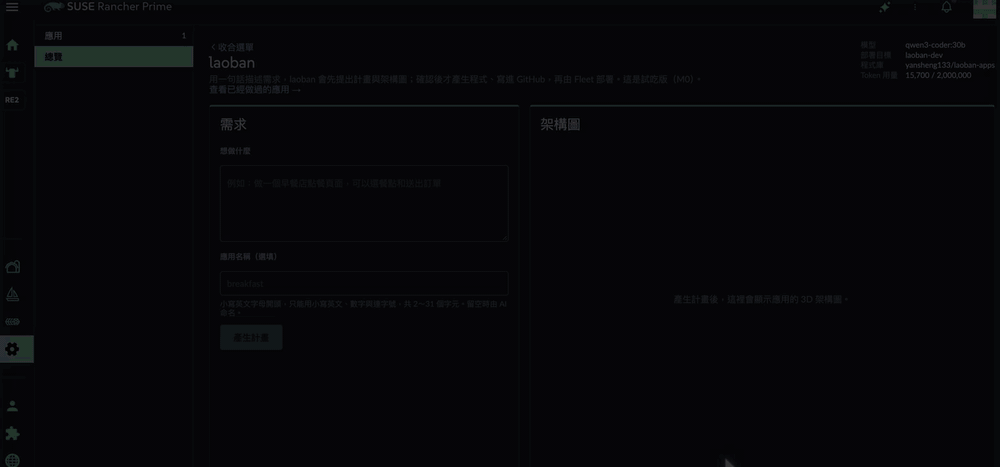
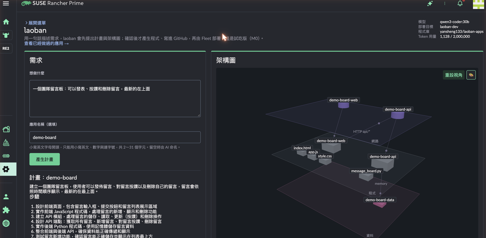
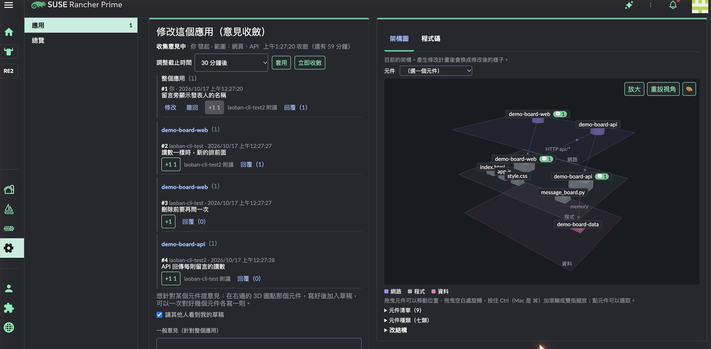
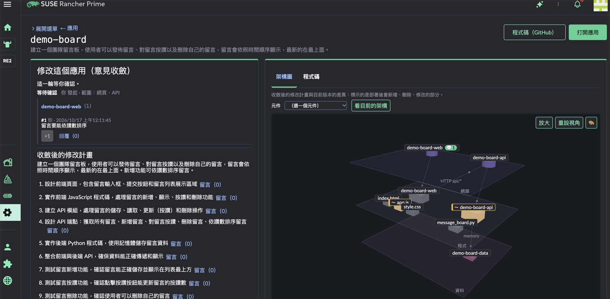
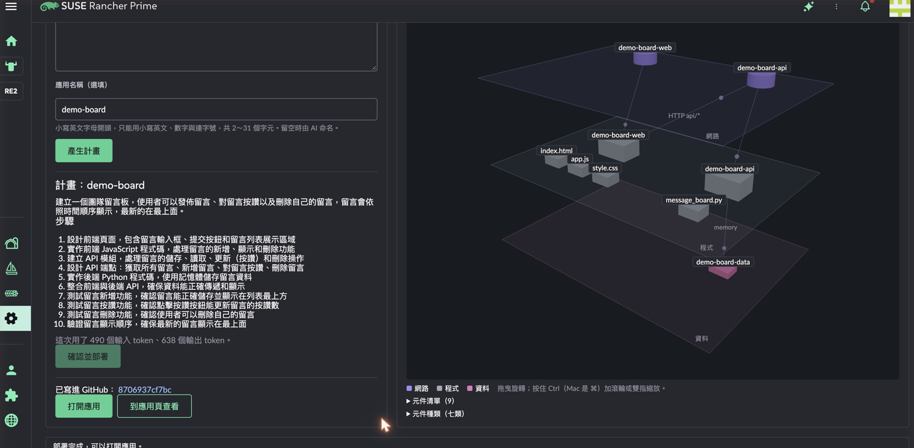
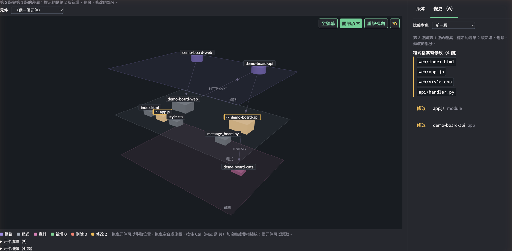
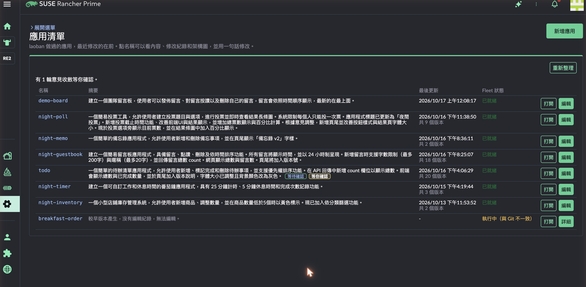

# laoban

繁體中文 · [English](README.en.md) · [日本語](README.ja.md)

laoban（老闆）是一個 Rancher UI extension：用一句話描述想要的應用，AI 先提出計畫與 3D 架構圖，你確認後才寫程式；程式寫進 GitHub，再由 Fleet 部署到 Rancher 管理的叢集。應用做好之後，團隊可以一起在 3D 架構圖上針對元件提意見，由 AI 收斂成一份修改計畫，提意見的人都確認後才發布新版。

> 專案暱稱「鐵板麵加雞塊」。名稱的由來：對系統說需求，就像在早餐店跟老闆點餐。



| 一句話 → 計畫與 3D 架構圖 | 一起提意見 | AI 收斂成修改計畫 |
|---|---|---|
|  |  |  |
| **部署完成** | **版本比較** | **應用清單** |
|  |  |  |

## 試用

照 **[快速上手](docs/quickstart.md)** 做，大約 30 分鐘：

1. 在 Rancher 的 Extensions 加入 Helm repo `https://yansheng133.github.io/laoban`，安裝 **laoban**（0.1.18 以後；0.1.17 的 extension 載入不了）。
2. 用 Helm 安裝後端（`laoban/laoban-crd`、`laoban/laoban`）。
3. 建一個 Fleet GitRepo 指向放應用的 GitHub repo。

需要 Rancher 2.15、一個 GitHub repo 與 token、Anthropic API key（或相容的本機模型）。每個版本的變更見 [Releases](https://github.com/yansheng133/laoban/releases)。

## 狀態

試吃版（M0），版本 0.1.x，還在密集修改，尚未正式發行。以 Rancher Prime 2.15.2 為基準，目前只在 ARM64 上完整驗證過。M0 的範圍與規格見 [docs/m0-design.md](docs/m0-design.md)。

laoban 是社群開源專案，**不在 SUSE 的支援範圍內**。

## 現在能做什麼

**做一個新應用**
- 在「總覽」輸入一句需求，AI 回一份計畫（摘要、步驟）和 3D 架構圖。
- 確認後，AI 寫出程式（網頁加 API），套上固定的部署範本 commit 到 GitHub，由 Fleet 部署。頁面追蹤部署狀態，完成後給出應用的連結。
- 產生的應用固定是兩個元件：網頁與 API，跑在 SUSE BCI Python 映像上。

**一起修改：意見收斂**
- 在應用的詳細頁開一輪意見收斂，設定收斂時間（立即，或 10 分鐘～24 小時）與範圍（網頁、API 或整個應用）。
- 每個人可以提一般意見，也可以在 3D 圖上點元件、針對那個元件提意見，一次可以對好幾個元件各寫一則。
- 意見可以 +1、回覆；作者在收集期間可以改寫或撤回自己的意見。3D 圖上標出每個元件有幾則意見。
- 寫到一半的草稿存在這一輪裡，換電腦也還在，預設其他人也看得到。
- 發起人可以調整截止時間，或立即收斂。
- 收斂好的計畫，大家可以針對某一步留言；有人提出異議時，這些留言會跟著意見一起交給 AI。
- 時間到了，AI 把所有意見（依元件分組、附上附議與回覆）收斂成一份修改計畫，在 3D 圖上標出會新增、修改、刪除哪些部分。
- 提意見的人都確認後，AI 寫程式並發布新版。有異議可以退回重新收斂；發起人可以略過沒有回覆的人。
- 一輪存在叢集裡，後端重啟或升級後照常進行；結束的一輪歸檔到應用 repo 的 `laoban-rounds` 分支，詳細頁可以看過去每一輪。
- 等你確認的輪次會標在應用清單上，左側選單也顯示件數；確認過的人看得到還在等誰、失敗了沒。
- 意見、回覆有字數上限，頁面上即時顯示字數與這一輪還剩多少空間；貼上太長的文字不會被截斷，但要精簡後才能送出。

**看懂架構和版本**
- 3D 架構圖分網路、程式、資料三層，可以旋轉、縮放、拖曳元件調整版面並存成新版本。
- 3D 圖可以放大到整個視窗或全螢幕，側欄有版本時間軸、變更清單與意見。
- 每一版都是一個 Git commit。選一個舊版，可以跟前一版比（這一版改了什麼），或跟目前版本比（還原後會改什麼）。變更清單列出架構的變動與改到的程式檔。可以還原到任何一版。
- 3D 圖有四種配色，選取的元件以光圈與連線標示。

**不經過 AI 的修改**
- 程式碼分頁直接編輯四個程式檔，存成新版本（經過跟 AI 產生的程式相同的檢查）。
- 「改結構」在 3D 圖上改名、刪除、新增連線或模組，這些會變成修改意見，再走 AI 計畫與確認。

**身分與權限**
- 後端是 Kubernetes aggregated API：瀏覽器經 Rancher 代理、以使用者自己的登入呼叫，由 API server 驗證身分並用使用者的 RBAC 授權。在目標 namespace 有 edit 權限的人可以使用，有 view 的人可以看。
- Rancher Project 成員可以用 Project 角色「laoban user」「laoban viewer」（`deploy/rancher/`）。
- 每一版、每則意見都記錄是誰做的。

**其他**
- 介面有繁體中文、英文、日文，跟著 Rancher 的語言設定。
- Rancher 的側邊選單可以收合，把空間留給工作區。
- AI 的工作（計畫、寫程式、收斂）在後端背景執行，頁面查進度，不受 API server 約 60 秒的請求上限影響。
- 送給 AI 前先遮蔽常見的敏感資料（身分證字號、卡號與帳號、API key／token、私鑰、密碼）；遮蔽靠格式辨識，不保證抓到所有機密，請不要把機密寫進需求或意見。有全域的 token 用量上限。
- AI 可以接 Anthropic API，也可以接相容 Anthropic Messages API 的本機模型（例如 Ollama）。
- 錯誤回應同時是 Kubernetes 的 `Status`，`kubectl create --raw` 也看得到原因（後端寫的訊息是繁體中文；頁面上常見的錯誤依介面語言顯示）。

## 運作方式

```
瀏覽器（Rancher 裡的 laoban 頁面）
  │  以使用者自己的 Rancher 登入
  ▼
Rancher 代理 → 目標叢集的 Kubernetes API server（驗證身分、RBAC 授權）
  ▼
laoban 後端（aggregated API）── 遮蔽 ──► AI（Anthropic API 或本機模型）
  │  commit 程式與部署範本
  ▼
GitHub repo ──► Fleet ──► 目標 namespace 裡的應用
```

後端只寫入自己在 `laoban-system` 的狀態資源（意見收斂的 `Round`、等待確認的計畫 `Plan`、每月 token 用量 `TokenUsage`，讓它們在後端重啟或升級後還在），應用的部署全部由 Fleet 負責。

## 限制

- 一個 Rancher 只用一套後端：頁面在使用者看得到的叢集裡找第一個裝了 laoban 的。
- 產生的應用固定是網頁加 API 兩個元件（Python），部署在一個 namespace（預設 `laoban-dev`），以 Pod Security restricted 執行。
- 後端只有一個副本；意見收斂、等待確認的計畫與每月 token 用量存在 `laoban-system` 的 `Round`、`Plan`、`TokenUsage` 資源裡，後端重啟不會遺失。
- AI 的費用由你的 Anthropic 帳號支付。後端有每月 token 上限（預設 2,000,000），但那只是 laoban 自己的計數；請一定要在 Anthropic Console 設花費上限。
- 後端訊息預設是英文，chart 的 `config.language: zh-Hant` 改成繁體中文；頁面依 Rancher 的語言設定顯示。

## 安裝（細節）

- 一般使用：見 [docs/quickstart.md](docs/quickstart.md)。
- 後端 chart 的所有設定：[charts/laoban/README.md](charts/laoban/README.md)。
- 事先建立的 namespace 與 Fleet 物件：[deploy/m0/README.md](deploy/m0/README.md)。
- Rancher Project 角色：[deploy/rancher/README.md](deploy/rancher/README.md)。
- UI extension 的開發與建置：[extension/README.md](extension/README.md)。
- 容器映像檔的建置與簽章：[build/README.md](build/README.md)。
- 發布流程：打 `vX.Y.Z` tag 後，`image` workflow 建映像檔，`publish` workflow 把 extension 與兩個 chart 加進 `gh-pages` 分支的 Helm repo，並建立 GitHub Release。

## 目錄

| 路徑 | 說明 |
|---|---|
| `extension` | Rancher UI extension（`laoban-ext`）：總覽、應用清單、應用詳細頁（意見收斂、3D 架構圖、版本、程式碼）。見 [extension/README.md](extension/README.md) |
| `crates/laoban-server` | 後端服務：aggregated API（TLS、request-header 身分驗證）、健康檢查 |
| `crates/laoban-m0` | 試吃版的流程：AI 計畫與架構圖、產生程式、意見收斂、版本與還原、固定範本的 manifest、commit 到 GitHub |
| `crates/laoban-ai` | AI 呼叫協調層：供應商抽象、錯誤分類與重試、全域 token 預算、送出前遮蔽、提示注入緩解、AI 回應的結構與允許清單驗證 |
| `crates/laoban-mask` | 敏感資料遮蔽引擎：送給 AI 之前與寫入稽核紀錄之前都用同一套規則 |
| `crates/laoban-audit` | 稽核紀錄：遮蔽後輸出 RFC 5424 syslog 訊息、RFC 5425 封框，以及依大小輪替的本機檔案 |
| `crates/laoban-policy` | 部署審查政策引擎（第一階段用）：決定一次變更能不能直接部署、要不要人工審查、由誰審 |
| `crates/laoban-mockhttp` | 測試用的本機 HTTP 模擬伺服器 |
| `charts/laoban` | 後端的 Helm chart：Deployment、APIService、使用者的 RBAC 規則、後端存 Round、Plan、TokenUsage 的 Role |
| `charts/laoban-crd` | laoban 的 CRD：`Round`、`Plan`、`TokenUsage`（試吃版就要裝），以及第一階段用的 ProjectPolicy、ChangeRequest、ArchitectureVersion |
| `deploy/m0` | 試吃版要事先建立的 namespace 與 Fleet 物件 |
| `web/viewer-prototype` | 3D 架構視圖的原型，extension 的 3D 圖由它移植 |
| `Containerfile`、`build/` | 容器映像檔：SUSE BCI 多階段建置、x86-64／ARM64 原生建置、推送 GHCR、cosign 簽章與 SBOM |
| `docs/m0-design.md` | 試吃版設計：範圍、API、流程、頁面與設定 |

## 開發

```bash
# 後端
cargo test --workspace
cargo clippy --workspace --all-targets -- -D warnings

# UI extension
cd extension
yarn install --frozen-lockfile
yarn build-pkg laoban-ext
yarn test

# 3D 原型
node --test web/viewer-prototype/*.test.mjs
```

## 支援

laoban 是社群開源專案，不在 SUSE 的支援範圍內。問題請開 [GitHub issue](https://github.com/yansheng133/laoban/issues)。

## 授權

Apache License 2.0，見 [LICENSE](LICENSE)。
